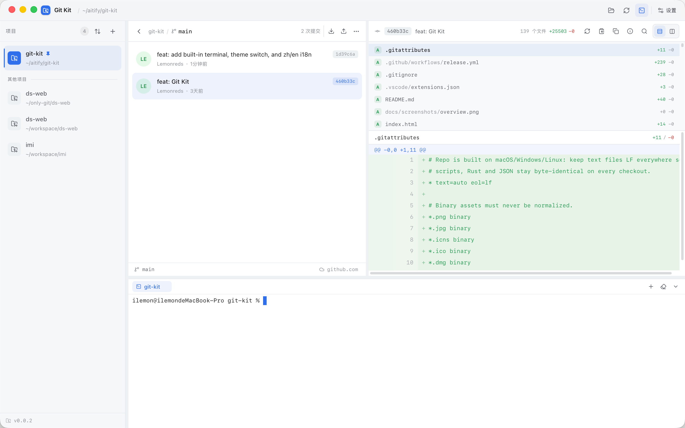

# Git Kit

**把日常的 Git 协作流程收进一个窗口。** 左侧项目、中间分支 / 提交 / 改动、右侧逐行对比 —— 建分支、看改动、推送、拉取、处理冲突，都在同一个界面里完成，且每个有风险的动作用前都会先告诉你后果。

---

## 这是什么

大多数 Git 客户端要么面向「一次性操作」（克隆、提交、推送各点一次），要么假设你熟悉命令行。Git Kit 面向的是每天在几个仓库、几条长期分支之间来回切换的协作场景：

- **分支是一等公民**：分支列表就是主界面，命名模板、ahead/behind、最近提交、一次点击切换/拉取/推送。
- **标签也是一页**：中间栏的「标签」页签列出全部标签，⌘⇧T 直接进入；支持按名称 / 说明 / 提交号搜索、筛选「未推送」、一键新建或删除，需要对比时再点一下同步远程（`git ls-remote`，这是标签唯一的联网读操作）。
- **动手前先看预览**：推送会列出将被覆盖的远程提交，拉取会告诉你能否快进，rebase 会列出将重放的提交。
- **危险操作必须显式确认**：强制推送使用 `--force-with-lease`，删除未合并分支要二次确认，删标签可以选择是否连带删 remote。
- **冲突就地解决**：merge / rebase / cherry-pick 停在冲突时，右侧列直接变成冲突解决视图——逐块「采用我方 / 采用对方 / 两者都保留」，也可以点行把它加进结果或直接编辑结果；解决后自动写入工作区并暂存，然后跳到下一个冲突文件。
- **文件历史与 Blame**：在右侧列的就文件切换「历史 / Blame」页签，历史会跟随重命名，Blame 按可见窗口按需计算，点击某一行可以跳到对应提交查看它对这个文件改了什么。
- **终端就在项目旁边**：从项目行直接为某个仓库开一个内置终端（⌘J 收起 / 展开），默认落在仓库根目录，最多同时保留 3 个会话，最久未用的自动关闭；面板右上角显示当前分支，⌘X（Windows 为 Ctrl+X）清空当前输入行。
- **本地优先**：读操作默认直接读本地仓库，不联网、无遥测、无账号（只有你主动点击「同步远程标签」时才执行一次 `git ls-remote`）；写操作调用你机器上的 `git`，复用已有的 SSH key、凭据助手和 hooks。

## 界面

*左侧项目、中间分支 / 标签 / 提交 / 改动、右侧改动文件与逐行对比 —— 三栏宽度可拖拽并记忆，默认浅色，可在设置中切换到深色（只作用于应用界面，终端与标题栏保持浅色）。*

## 技术栈

| 层 | 选型 |
| --- | --- |
| 桌面外壳 | Tauri 2（macOS Overlay 标题栏；Windows MSI / NSIS） |
| 后端 | Rust，`git2`（libgit2）负责读取，`git` CLI 负责写入与网络 |
| 终端 | `portable-pty`（Rust，openpty / ConPTY）+ xterm.js（按需动态加载） |
| 前端 | React 19 + TypeScript、Vite、Tailwind CSS v4、zustand、react-window、lucide-react |
| 打包 | 平台脚本 + GitHub Actions（tag 触发双平台 Release） |
