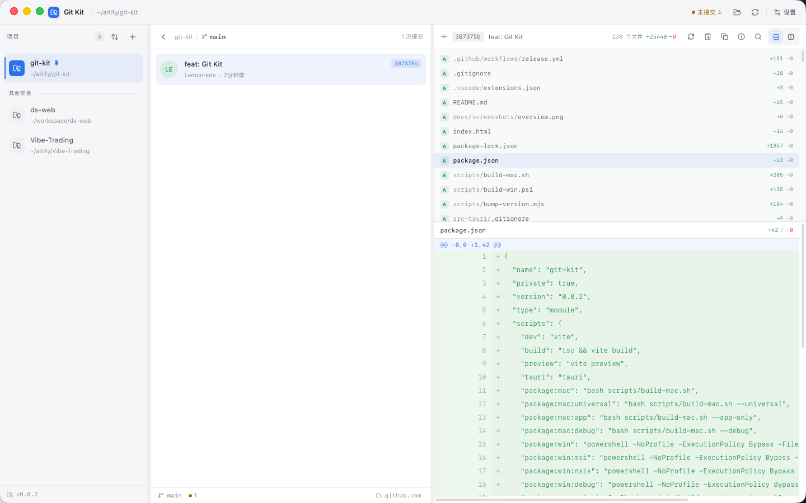

# Git Kit

**把日常的 Git 协作流程收进一个窗口。** 左侧项目、中间分支 / 提交 / 改动、右侧逐行对比 —— 建分支、看改动、推送、拉取、处理冲突，都在同一个界面里完成，且每个有风险的动作用前都会先告诉你后果。

---

## 这是什么

大多数 Git 客户端要么面向「一次性操作」（克隆、提交、推送各点一次），要么假设你熟悉命令行。Git Kit 面向的是每天在几个仓库、几条长期分支之间来回切换的协作场景：

- **分支是一等公民**：分支列表就是主界面，命名模板、ahead/behind、最近提交、一次点击切换/拉取/推送。
- **动手前先看预览**：推送会列出将被覆盖的远程提交，拉取会告诉你能否快进，rebase 会列出将重放的提交。
- **危险操作必须显式确认**：强制推送使用 `--force-with-lease`，删除未合并分支要二次确认，删标签可以选择是否连带删 remote。
- **本地优先**：读操作直接读本地仓库，不联网、无遥测、无账号；写操作调用你机器上的 `git`，复用已有的 SSH key、凭据助手和 hooks。

## 界面

*左侧项目、中间提交历史、右侧改动文件与逐行对比 —— 三栏宽度可拖拽并记忆，浅色默认、跟随系统切换深色。*

| 栏位 | 内容 |
| --- | --- |
| 左栏 | 项目（可置顶、可排序）、添加/重定位仓库、版本号 |
| 中栏 | 分支列表 / 提交历史 / 工作区改动，底部状态栏显示当前分支与未提交数 |
| 右栏 | 选中提交或文件的逐行 diff，统一视图与分栏视图 |

## 技术栈

| 层 | 选型 |
| --- | --- |
| 桌面外壳 | Tauri 2（macOS Overlay 标题栏；Windows MSI / NSIS） |
| 后端 | Rust，`git2`（libgit2）负责读取，`git` CLI 负责写入与网络 |
| 前端 | React 19 + TypeScript、Vite、Tailwind CSS v4、zustand、react-window、lucide-react |
| 打包 | 平台脚本 + GitHub Actions（tag 触发双平台 Release） |
